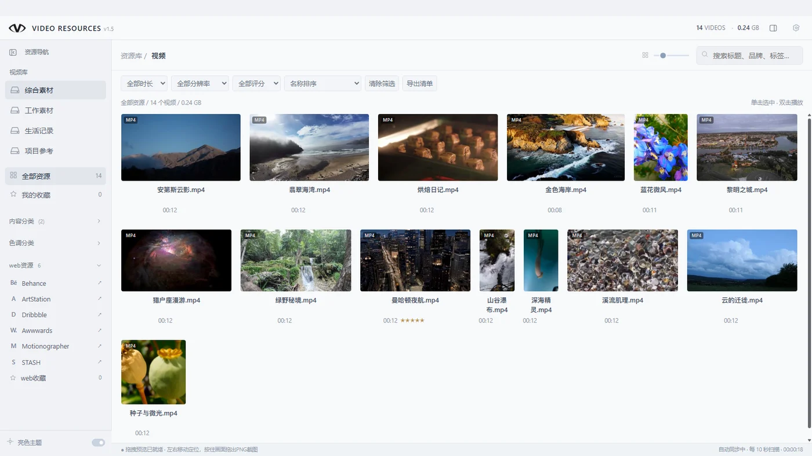
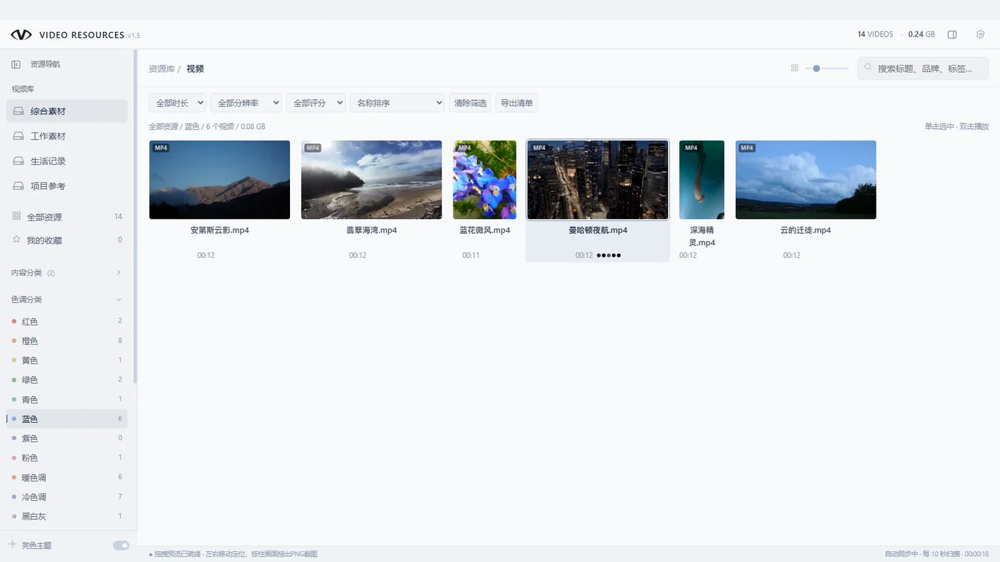
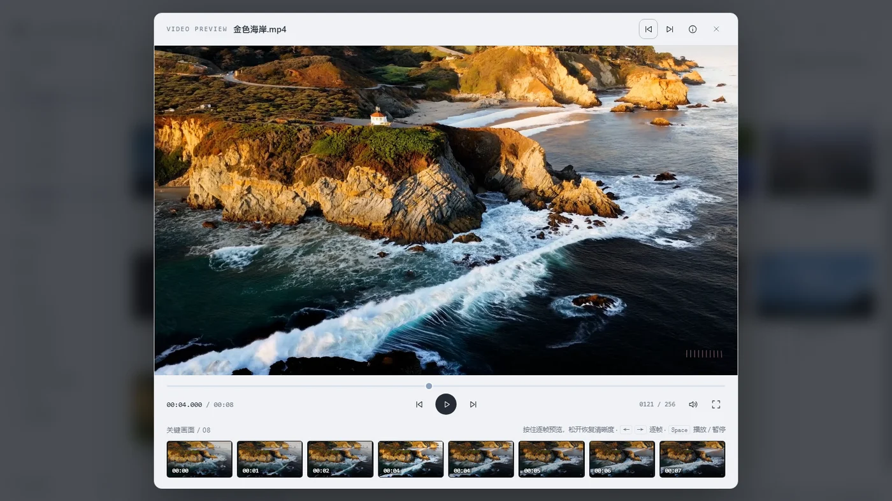
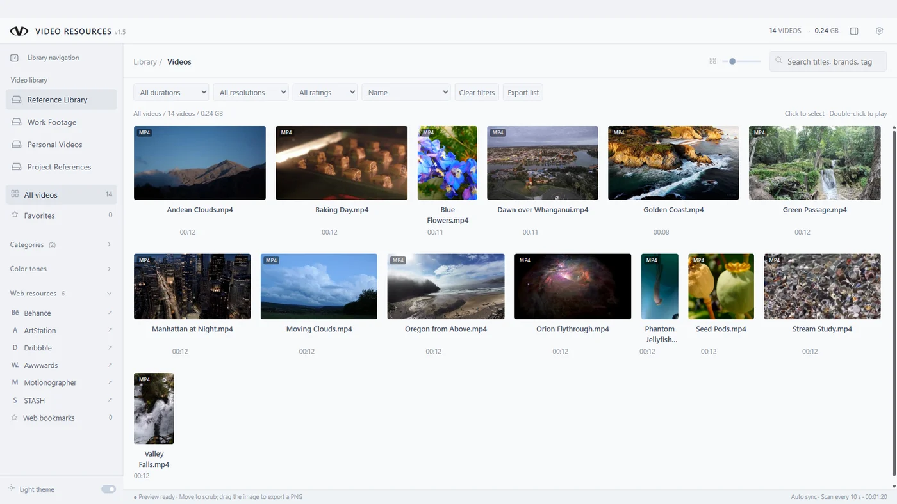

# VIDEO RESOURCES

**把散落在多层文件夹里的视频，变成一个看得见、找得到的素材库。**

[微软商店下载](https://apps.microsoft.com/detail/9n37d8ld993f) · [English](#english) · [版本记录](CHANGELOG.md) · [提交反馈](https://github.com/yujingyuhe/video-resources/issues/new)

选一个上层目录，VIDEO RESOURCES 会扫描其中的子目录，把分散的视频汇总显示。下次只记得画面时，可以从色调、内容、评分或收藏找回那段素材。

- **归总深层目录**　选中总目录即可开始。后续新增或移除的视频也会随扫描同步。
- **工作和生活分开管理**　默认库之外可添加并命名最多 10 个独立视频库，从侧栏切换。
- **按画面挑素材**　横屏、竖屏、方形缩略图按视频比例排列。悬停移动可预览，按空格进入播放器，用方向键逐帧查看。
- **看清文件参数**　在详情面板查看分辨率、帧率、编码、时长和文件大小。

| 按色调查找 | 逐帧查看与关键画面 |
| --- | --- |
|  |  |

适用于 Windows 10/11（x64）。首次打开时在设置中选择本地视频目录。演示素材只用于展示界面。

## English

**Find the clip you remember, even when it is buried in nested folders.**

[Get it from Microsoft Store](https://apps.microsoft.com/detail/9n37d8ld993f) · [Changelog](CHANGELOG.md) · [Report an issue](https://github.com/yujingyuhe/video-resources/issues/new)

Choose a parent folder and browse videos from its subfolders in one searchable local library. Filter by color tone, category, rating or favorites when you remember the shot but forgot the filename.

- Keep work footage, personal videos and project references in separate named libraries. Add up to 10 libraries alongside the default.
- Browse landscape, portrait and square thumbnails at their video aspect ratios. Scrub a thumbnail, open the player with Space and step through frames with the arrow keys.
- See resolution, frame rate, codec, duration and file size in the details panel.

For Windows 10/11 (x64). Choose a local video folder in Settings on first launch. Screenshots show a demo library.

## 素材署名 · Media credits

[截图素材 · Screenshot credits](Screenshot-Credits.txt) · [短片素材 · Short demo credits](Demo-Video-Credits.txt)
